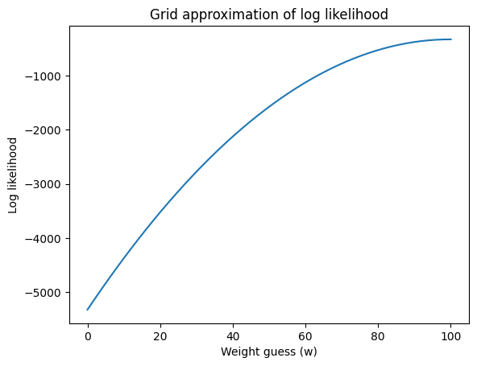
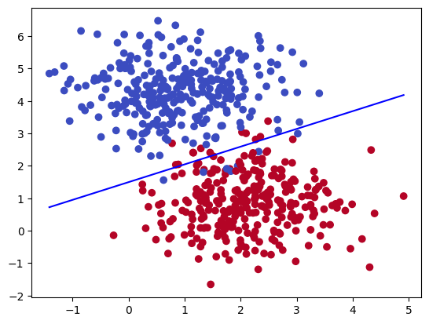

# Maximum Likelihood, MAP Estimation and Logistic Regression from Scratch

A hands-on treatment of **statistical estimation and binary classification**, written from scratch in NumPy: likelihood-based estimation, the role of priors, and a regularised logistic regression trained by gradient descent.

<p align="center">
  
  
</p>

## Contents

### 1. MLE and MAP

- A simulated measurement problem: estimating an object's true weight from 100 noisy measurements
- Maximum likelihood by grid approximation of the log-likelihood, and comparison with the closed-form estimator
- MAP estimation under different priors, showing when the prior dominates and when the data do
- Sensitivity of MAP estimates to prior choice and to grid resolution

### 2. Logistic regression from scratch

- Sigmoid link, cross-entropy cost with L2 regularisation, analytic gradients
- Batch gradient descent with convergence monitoring
- Decision boundaries for linearly separable and overlapping simulated classes
- An application to tweet sentiment classification with NLTK-based features

## Repository structure

```
MLE_MAP_LR.ipynb   # estimation, priors and logistic regression
figures/           # selected figures exported from the notebook
```

## Reproducing

```bash
pip install numpy matplotlib scipy scikit-learn nltk
```

## Context

Developed for the graduate Machine Learning course at Sharif University of Technology (2025).

---
**Shayan Pourmasoomi** · MSc Economics, Sharif University of Technology · [LinkedIn](https://www.linkedin.com/in/shayan-pourmasoomi-8b6206389)
